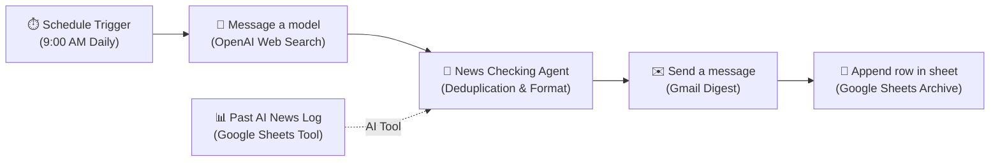

# 🤖 Automated-AI-News-Agent

[](https://n8n.io/)
[](https://opensource.org/licenses/MIT)
[](https://openai.com/)
[](https://workspace.google.com/products/sheets/)
[](https://mail.google.com/)

Autonomous **n8n** pipeline that searches daily AI research breakthroughs, cross-references Google Sheets for semantic deduplication, logs new updates, and delivers curated email digests straight to your inbox.


---

## 📌 Architecture & Workflow Flow



---

## 🚀 Key Features

- **🌐 Live Web Search**: Uses OpenAI's web search capability to scan the last 24 hours of announcements from frontier AI labs (OpenAI, Anthropic, Google, Meta, Mistral, xAI, Hugging Face).
- **🛡️ Intelligent Deduplication**: The AI news formatter agent queries your historical Google Sheet (`Past AI News Log`) before assembling the digest to ensure previously reported headlines are never repeated.
- **📬 Automated Email Digest**: Delivers clean, formatted bullet points with bolded key players and direct source links straight to your inbox via Gmail.
- **📂 Persistent Archive**: Automatically logs every day's digest with the date timestamp into Google Sheets for historical analysis.
- **🔒 Public-Ready & Sanitized**: All sensitive data, OAuth tokens, personal emails, private Google Sheet IDs, instance IDs, and execution cache (`pinData`) have been removed for safe sharing on GitHub.

---

## 📋 Workflow Nodes Breakdown

| Node Name | Type | Purpose |
| :--- | :--- | :--- |
| **Schedule Trigger** | `scheduleTrigger` | Triggers the pipeline every day at 9:00 AM local time. |
| **Message a model** | `@n8n/n8n-nodes-langchain.openAi` | Prompts OpenAI (`chat-latest`) with web search enabled to find top AI news from the last 24 hours. |
| **Past AI News Log** | `googleSheetsTool` | Connected as an AI tool to allow the formatter agent to read existing logs from Google Sheets. |
| **News Checking Agent** | `@n8n/n8n-nodes-langchain.openAi` | Cross-references fetched news against past logs, removes duplicates, and formats 1–2 sentence summaries with unfurled source URLs. |
| **Send a message** | `gmail` | Sends the synthesized digest to the configured recipient email address. |
| **Append row in sheet** | `googleSheets` | Appends a new row to Google Sheets containing `Date` and `Headlines`. |

---

## 🛠️ Prerequisites

Before importing this workflow, ensure you have:

1. **n8n** (Cloud or self-hosted, version `1.4+` or newer).
2. **OpenAI API Key**: Connected as an `OpenAI account` credential in n8n.
3. **Google Sheets OAuth2**: Connected as a `Google Sheets account` credential in n8n.
4. **Gmail OAuth2**: Connected as a `Gmail account` credential in n8n.

---

## ⚙️ Setup & Deployment Guide

### 1. Create your Google Sheet Archive
1. Go to [Google Sheets](https://sheets.new) and create a new blank spreadsheet.
2. Name the sheet (e.g., `AI News Archive`).
3. In row 1 of `Sheet1`, create two columns:
   - **Column A**: `Date`
   - **Column B**: `Headlines`
4. Copy your Google Sheet ID from the browser URL:
   ```
   https://docs.google.com/spreadsheets/d/<YOUR_GOOGLE_SHEET_ID>/edit
   ```

### 2. Import Workflow into n8n
1. In your n8n dashboard, click **Workflows** > **Add Workflow**.
2. Click the three dots menu (**...**) in the top right corner and select **Import from File...**.
3. Select `workflow.json` from this repository.

### 3. Replace Placeholders
Configure the imported nodes with your own credentials and IDs:

- **Past AI News Log (Node)**:
  - Connect your **Google Sheets OAuth2** credential.
  - Set **Document** to your spreadsheet using `YOUR_GOOGLE_SHEET_ID`.
  - Select your sheet/tab (e.g., `Sheet1`).
- **Send a message (Node)**:
  - Connect your **Gmail OAuth2** credential.
  - In `To Email` (`sendTo`), replace `your-email@example.com` with your real email address.
- **Append row in sheet (Node)**:
  - Connect your **Google Sheets OAuth2** credential.
  - Set **Document** to your spreadsheet using `YOUR_GOOGLE_SHEET_ID`.
  - Ensure column mappings match `Date` and `Headlines`.
- **OpenAI Nodes**:
  - Connect your **OpenAI** API credential to both `Message a model` and `News Checking Agent`.

### 4. Test & Activate
1. Click **Test Step** or **Execute Workflow** to run a manual test.
2. Check your inbox for the daily digest and verify the new row appended to your Google Sheet.
3. Toggle the workflow switch to **Active** to enable the daily 9:00 AM schedule.

---

## 🔒 Security & Privacy Notice

This repository has been sanitized following n8n security best practices:
- Cached test runs (`pinData`) are completely cleared.
- Personal emails and specific Google Sheet IDs are replaced with placeholders (`your-email@example.com` and `YOUR_GOOGLE_SHEET_ID`).
- Internal n8n instance telemetry identifiers (`meta.instanceId`) have been removed.
- Default state is set to `active: false` to prevent accidental triggers before configuration.

---

## 📄 License

This project is licensed under the [MIT License](LICENSE).
